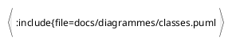

# API de bibliothèque de savoir SapientAPI

## Description
Cette api permet de déployer une bibliothèque de savoir. Elle comprends des collections pour les différents sujet, les types de documentations, la gestion des membres et l'accès aux ressources.

## Récits utilisateurs
[Récits utilisateurs](docs/user-stories/user-stories.md)

## Cas d'utilisations

## Diagramme de classes UML

## Installation
À venir!

## Usage
À venir!

## Contributeurs
- Émile Girard
- Émile Larochelle-Langevin

## Liscence
API de bibliothèque de savoir © 2025 by Émile Girard & Émile Larochelle-Langevin est distribué sous licence CC BY-NC-SA 4.0. 
Pour consulter les détails de la licence, visitez https://creativecommons.org/licenses/by-nc-sa/4.0/

## État du projet et plans futurs
Sprint 1 en cours - Analyse et mise en place du projet
